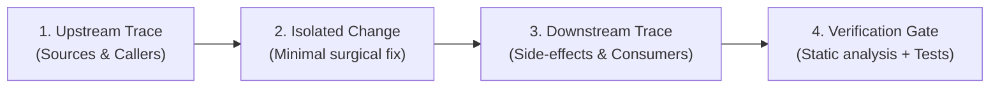

# Paatu Padava — Master Architecture, DSA, SD & Mobile Audit Rules

This document establishes the mandatory architectural laws, data structures & algorithms (DSA) standards, system design (SD) principles, and regression-prevention protocols for the Paatu Padava Flutter mobile application.

---

## 1. Core Architecture & Repository Bounds

* **Layered Separation of Concerns**:
  * `lib/ui/`: Strictly presentation and user interaction. No direct API calls, no raw database queries, no unmanaged business logic.
  * `lib/logic/`: ChangeNotifier and Stream-based state providers (`HomeFeedProvider`, `SearchQueryPlanner`).
  * `lib/data/`: Repositories mediating between local storage and remote sources (`SongRepository`).
  * `lib/services/`: Core infrastructure (`PlayerHandler`, `AuthManager`, `SettingsManager`, `SyncManager`, `CatalogDatabase`).
  * `lib/core/dsa/`: Pure algorithmic data structures (`MinHash`, `BKTree`, `SymSpell`, `TrigramIndex`).
* **Strict Project Constraints**:
  * Files $> 400$ lines count must remain **$\le 55$**. Every new screen/widget must be modularized under `lib/ui/widgets/<feature>/`.
  * GoogleFonts calls must remain **$\le 383$**. Reuse `AppTheme` and `AppColors` tokens; do not scatter ad-hoc font definitions.
  * **Zero Analyzer Errors**: All code must pass `analyze_files` with 0 warnings/errors.

---

## 2. DSA (Data Structures & Algorithms) Standards

Every data structure and algorithm in Paatu Padava is chosen for bounded memory and sub-millisecond execution:

1. **Fingerprinting & Deduplication ($O(1)$)**:
   * Use **MinHash** with 64 universal hash permutations (`core/dsa/minhash.dart`) for near-instant Jaccard similarity estimation between tracks across providers (JioSaavn, YouTube, Audius).
   * Do NOT use naive quadratic string comparisons ($O(N^2)$) on catalogs or search pools.
2. **Metric Space Typo Correction ($O(\log N)$)**:
   * **SymSpell** (`core/dsa/symspell.dart`): $O(1)$ lookup for edit distance $\le 2$ via precomputed deletion dictionary.
   * **BK-Tree** (`core/dsa/bk_tree.dart`): Burkhard-Keller metric tree for discrete Levenshtein distances when SymSpell yields no exact term match.
   * **Trigram Index** (`core/dsa/trigram_index.dart`): Inverted character tri-gram index for phonetic Tanglish transliteration matching.
3. **Memory & Rendering Budgets ($120\text{ Hz} / 8.33\text{ ms}$)**:
   * Any list view presenting $\ge 20$ items MUST use virtualized scrolling with fixed `itemExtent` (e.g. `72.0` for song tiles) or `SliverFixedExtentList`.
   * Heavy computations (Levenshtein matrices, JSON parsing of $> 500$ entities, vector cosine similarity) MUST NOT run in the Flutter UI thread / `build()` cycle. Use `compute()` or background isolates for batches $> 100$ items.
4. **Bounded Caching ($O(1)$ amortized)**:
   * Use bounded **LRU Caches** (`SearchCache`, `SmartCacheService`) with strict maximum capacities (e.g. 100 entries or 250 MB).
   * Use **Bloom Filters** or lightweight HashSets for recent history tracking to achieve $O(1)$ membership checks with zero memory growth.

---

## 3. System Design (SD) & Production Audio Standards

1. **Audio Engine Single Source of Truth**:
   * `PlayerHandler` is the solitary controller of the audio pipeline. UI components observe playback state via reactive streams (`mediaItem`, `playbackState`) and NEVER manipulate underlying audio players directly.
   * Background audio resilience: `onTaskRemoved()` and foreground notification service must respect the user's `isPersistentBackgroundPlaybackEnabled` setting.
2. **Zero-Latency Stream Pre-Warming**:
   * Pre-resolve audio streams (`DefaultStreamResolver.prewarmSongs`) for the top 3 items in feeds or confirmed search results so playback starts in $< 50\text{ ms}$.
   * Pre-warming must be debounced ($\ge 450\text{ ms}$) and triggered ONLY on explicit search submit or final feed render—never on active typing keystrokes.
3. **Offline-First & Eventual Consistency**:
   * Every user mutation (likes, history, playlist edits, taste preferences) MUST be stored locally first in Hive (`< 2\text{ ms}`) before dispatching to Supabase.
   * **No Swallowed Exceptions**: Any network or socket failure during remote sync must enqueue a persistent pending record (e.g. `pending_user_taste`, `pending_playlist_mutation`) in Hive.
   * `SyncManager.syncAll()` and session reconnect listeners must automatically flush pending queues as soon as connectivity resumes.
4. **Multi-Language Parity (No First-Language Monopoly)**:
   * Users who select multiple preferred languages (e.g. Tamil + Hindi + English) must receive equal first-class status across all features:
     * Artist screen must not demote secondary preferred languages as mismatches.
     * Recommendations and search scoring must boost tracks from **any** language in the user's preferred set.
     * Fallback and global search must search across all languages unless the user explicitly taps a single-language chip.
5. **Bidirectional State Synchronization**:
   * `AuthManager.currentUser` (cloud profile) and `SettingsManager` (local Hive cache) must remain bidirectionally synchronized on login, profile update, and sign-out to prevent state drift.

---

## 4. Industry Benchmark Comparison Rules

Whenever reviewing, designing, or fixing features, measure against top-tier music applications:

| Benchmark App | Standard to Emulate in Paatu Padava | What to Avoid |
|---|---|---|
| **Spotify** | • Infinite progressive scroll (infinite batches until catalog end, not fixed 25 cutoffs). • Smart Shuffle with Poisson-spaced artist distribution. • Seamless persistent mini-player with drag-up gesture. • Instant ThumbHash / LQIP blurred placeholder. | • Fixed cutoff pagination that stops abruptly. • Same-artist back-to-back track clustering. • Hard white screen flashes while images load. |
| **Apple Music** | • Multi-language equality without language silo walls. • Studio-grade metadata preservation (composers, release year, track numbering). • Crisp typographic hierarchy without overflowing on small viewports (360dp). | • Forcing a user's 2nd or 3rd language to the bottom. • Truncated titles without proper `TextOverflow.ellipsis`. • Guessed or fake release years. |
| **YouTube Music** | • Resilient provider fallbacks (Saavn 320k $\to$ YouTube audio stream $\to$ Audius). • Automatic stream failover to next playable candidate on CDN 403/404. • Unified media notification with seek, skip, and like controls. | • Stopping playback when a single stream link expires. • Showing duplicate search entries with different bitrates. |

---

## 5. Mandatory 4-Step Ripple-Effect & Regression Protocol

Before applying ANY bugfix, refactoring, or enhancement, you MUST execute this analysis:

1. **Step 1: Upstream Trace (Data Sources & Invariants)**
   * Identify every caller of the method or consumer of the model being edited.
   * Check nullability, empty list fallbacks, and multi-tenant guest vs. authenticated conditions.
2. **Step 2: Second-Order Ripple Analysis (What Else Can Break?)**
   * *If I loosen search language filtering, will Bollywood Hindi flood Tamil folk searches?* (Ensure query intent classifier distinguishes regional keywords).
   * *If I change artist discography sorting, will instrumental soundtracks break?* (Check composer vs singer tags).
   * *If I cache stream URLs, will expiring CDN tokens cause playback failures after 2 hours?* (Cache stream resolvers, not expiring pre-signed URLs).
   * *If I add an async sync step to login, will it delay navigation?* (Run cloud synchronization with `unawaited()` or background microtasks).
3. **Step 3: Layout & Responsive Survivability**
   * Does this UI survive **360x640 dp** at **text scale 1.5**?
   * Is the bottom padding accounting for `miniPlayerHeight + bottomNavHeight + safeArea`?
4. **Step 4: Strict Verification Gate**
   * Run `dart-mcp-server` tool `analyze_files` on all modified paths. Require **0 errors**.
   * Run corresponding unit tests or create an explicit regression test in `mobile/test/`.
   * Confirm file count $> 400$ lines remains $\le 55$ and GoogleFonts calls remain $\le 383$.
